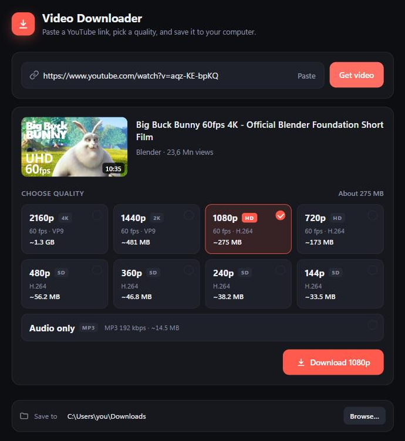

# Video Downloader

A simple app that runs on your own computer for downloading YouTube videos. Paste a link, pick a quality, and the file goes to your Downloads folder.



## Features

- **Choose a quality:** every resolution the video has, from 144p up to 4K and 8K, with the estimated file size of each
- **Audio only:** save just the sound as a 192 kbps MP3
- **Live progress:** see the percentage, speed and time left, and cancel at any point
- **Several downloads at once:** paste the next link while earlier ones are still downloading
- **Plays everywhere:** up to 1080p it picks H.264, which plays in any player
- **Open the result:** **Open** plays the finished file and **Show in folder** opens it in Explorer. **Browse…** changes the save folder
- **No extra installs:** ffmpeg comes bundled, so you don't have to install it yourself
- **Private:** it runs only on your computer and accepts connections from this machine only

## Requirements

- **Python 3.10 or newer**, from [python.org](https://www.python.org/downloads/)
- **Node.js, Deno or Bun.** YouTube needs a JavaScript runtime for yt-dlp to read videos, and [Node.js](https://nodejs.org/) is the easiest one to get.

## Quick start

```bash
git clone https://github.com/aygunvarol/yt-video-downloader.git
cd yt-video-downloader
```

**Windows:** double-click `start.bat`.

**macOS / Linux:**

```bash
chmod +x start.sh
./start.sh
```

The first run sets up a virtual environment and installs the dependencies, which takes about a minute. After that it opens <http://127.0.0.1:5000> in your browser. To stop it, press `Ctrl+C` in the terminal window.

### Manual setup

```bash
python -m venv .venv
.venv\Scripts\activate          # Windows
source .venv/bin/activate       # macOS / Linux
pip install -r requirements.txt
python app.py
```

## Project layout

```
app.py              Flask server: reads video info, runs downloads, reports progress
static/index.html   The whole UI (HTML, CSS and JavaScript in one file)
requirements.txt    Python dependencies
start.bat           Windows launcher (sets up on first run, updates yt-dlp)
start.sh            macOS / Linux launcher
```

## How it works

- **Video info:** [yt-dlp](https://github.com/yt-dlp/yt-dlp) reads the video's details and lists its formats. The app groups them by resolution and estimates each file's size.
- **Merging:** YouTube serves 720p and higher as separate video and audio streams. The bundled ffmpeg from [imageio-ffmpeg](https://github.com/imageio/imageio-ffmpeg) merges them into one `.mp4`.
- **Codecs:** 1440p and 4K come only as VP9 or AV1. These play in VLC, or in Windows "Films & TV" once the free VP9/AV1 extensions are installed.

## Configuration

| Environment variable | Default            | Purpose                  |
|----------------------|--------------------|--------------------------|
| `YTD_DIR`            | `~/Downloads`      | Default save folder      |
| `YTD_PORT`           | `5000`             | Port the UI runs on      |

You can also change the save folder in the app with **Browse…**. The app remembers your choice.

## Troubleshooting

- **"This video is unavailable" or downloads stop working:** YouTube changes often. The launchers update yt-dlp every time they start. To update it by hand:
  ```bash
  .venv\Scripts\python -m pip install -U "yt-dlp[default]"
  ```
- **No formats, or only low qualities:** install Node.js (or Deno) so yt-dlp can solve YouTube's JavaScript challenges.
- **Port 5000 is already in use:** set a different port, for example `set YTD_PORT=5050` on Windows or `export YTD_PORT=5050` on macOS/Linux.

## Disclaimer

This is a personal tool. Only download videos you own or have permission to save, and respect YouTube's Terms of Service and creators' rights.

## License

[MIT](LICENSE)
